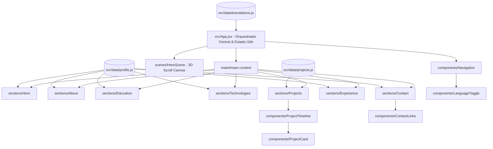

<!-- Este README segue o template de excelência acadêmica e profissional recomendado pelo Prof. Dr. João Paulo Aramuni (PUC Minas) -->

---

# 🏷️ Portfólio Profissional — Frederico Marques 👨‍💻

> [!NOTE]
> **Understanding. Building. Evolving.**  
> Aplicação web de página única, narrativa e experimental, com cena 3D contínua orientada ao scroll e suporte bilíngue completo. Apresenta a trajetória acadêmica, competências em engenharia de software e vivência de liderança na Ordem DeMolay de **Frederico Marques**.

<table>
  <tr>
    <td width="820px">
      <div align="justify">
        Este repositório contém a versão definitiva do <b>Portfólio Profissional de Frederico Marques</b>, estudante do 2º período de <b>Engenharia de Software na PUC Minas</b>. Inspirado no ritmo visual e presença editorial do site de Lando Norris, mas com <i>identidade própria</i> fundamentada no rigor da engenharia e na ética cavalheiresca, o projeto une tecnologias modernas de desenvolvimento web (<b>React 19</b>, <b>Vite 8</b> e <b>Three.js</b>) a uma narrativa interativa que acompanha o usuário ao longo de toda a rolagem da página. O objetivo deste projeto é apresentar de forma transparente, mensurável e original as competências técnicas, projetos com impacto social e a busca pela primeira oportunidade profissional como desenvolvedor de software.
      </div>
    </td>
    <td align="center" width="160px">
      <div>
        
      </div>
    </td>
  </tr> 
</table>

---

## 🚧 Status do Projeto

[](https://portifolio-i1mc.onrender.com/)
[](#)


[](#-licença)

---

## 📚 Índice

- [🔗 Links Úteis](#-links-úteis)
- [📝 Sobre o Projeto](#-sobre-o-projeto)
- [✨ Funcionalidades Principais](#-funcionalidades-principais)
- [🛠 Tecnologias Utilizadas](#-tecnologias-utilizadas)
  - [💻 Front-end](#-front-end)
  - [🖥️ Back-end & BaaS (Projetos em Destaque)](#️-back-end--baas-projetos-em-destaque)
  - [⚙️ Infraestrutura, Build & Qualidade](#️-infraestrutura-build--qualidade)
- [🏗 Arquitetura](#-arquitetura)
  - [Separação Modular de Responsabilidades](#separação-modular-de-responsabilidades)
  - [Jornada 3D Contínua Orientada ao Scroll](#jornada-3d-contínua-orientada-ao-scroll)
- [🧭 Linha do Tempo Cronológica de Projetos](#-linha-do-tempo-cronológica-de-projetos)
- [🔧 Instalação e Execução](#-instalação-e-execução)
  - [Pré-requisitos](#pré-requisitos)
  - [Instalação de Dependências](#-instalação-de-dependências)
  - [Execução em Modo de Desenvolvimento](#-execução-em-modo-de-desenvolvimento)
  - [Validação com Oxlint e Build de Produção](#-validação-com-oxlint-e-build-de-produção)
- [🌐 Aplicação Publicada](#-aplicação-publicada)
- [📂 Estrutura de Pastas](#-estrutura-de-pastas)
- [🎥 Demonstração das Seções](#-demonstração-das-seções)
- [🧪 Testes e Validação](#-testes-e-validação)
- [🔗 Documentações Utilizadas](#-documentações-utilizadas)
- [👥 Autores](#-autores)
- [🤝 Contribuição](#-contribuição)
- [🙏 Agradecimentos](#-agradecimentos)
- [📄 Licença](#-licença)

---

## 🔗 Links Úteis

* 🌐 **Aplicação Web (Render):** [https://portifolio-i1mc.onrender.com/](https://portifolio-i1mc.onrender.com/)
  > 💻 **Descrição:** Link de produção pública com HTTPS ativo, CDN global e deploy automatizado.
* 🐙 **Repositório no GitHub:** [github.com/fredmarques916/portifolio](https://github.com/fredmarques916/portifolio)
  > 📁 **Descrição:** Código-fonte integral versionado, histórico de commits e documentação do projeto.
* 💼 **LinkedIn do Desenvolvedor:** [linkedin.com/in/fredmarques916](https://www.linkedin.com/in/fredmarques916/)
  > 🤝 **Descrição:** Conexão profissional e histórico acadêmico/profissional.
* 📧 **Contato por E-mail:** [fredmarques916@gmail.com](mailto:fredmarques916@gmail.com)
  > ✉️ **Descrição:** Canal direto para propostas, entrevistas e colaborações técnicas.

---

## 📝 Sobre o Projeto

O **Portfólio Profissional de Frederico Marques** foi concebido para atender a um propósito central: **tornar tangíveis a curiosidade técnica, o método de engenharia e a capacidade de execução** de um desenvolvedor full stack em formação.

### 🎯 Motivação e Contexto
- **Por que ele existe:** Para superar os formatos convencionais de currículo estático, oferecendo aos recrutadores e líderes técnicos uma experiência viva e imersiva do que o desenvolvedor é capaz de conceber e entregar com código limpo.
- **Qual problema ele resolve:** Demonstra em um único ponto de contato a evolução real de Frederico Marques, desde os fundamentos web (*Solidariza*), passando pela arquitetura reativa com BaaS relacional (*Expandindo Horizontes*), até a ingestão de telemetria IoT em tempo real (*BioSense*).
- **Identidade e Princípios:** Fundamentado na assinatura **“Understanding. Building. Evolving.”** e nos princípios éticos da **Ordem DeMolay**, o projeto equilibra inovação gráfica arrojada (inspirada na estética automobilística e editorial de alta intensidade de Lando Norris) com usabilidade, acessibilidade e desempenho.
- **Onde pode ser utilizado:** Como cartão de visita técnico para processos seletivos de estágio e vagas júnior em desenvolvimento de software, bem como referência de portfólio acadêmico na PUC Minas.

> [!NOTE]
> Todo o conteúdo exibido é estritamente baseado em fatos reais e auditáveis da trajetória do desenvolvedor, sem inclusão de certificações fictícias, números artificiais ou métricas infladas.

---

## ✨ Funcionalidades Principais

- 🌌 **Jornada 3D Contínua Orientada ao Scroll (Three.js):** Escultura 3D autoral que transita suavemente entre quatro estágios narrativos conforme a rolagem da página:
  1. *Core Monolith* (Hero)
  2. *Constelação das 7 Virtudes DeMolay* (Sobre)
  3. *Rede Regional de Visitação* (Projetos)
  4. *Selo Heráldico de Liderança* (Contato)
- 🛰️ **HUD de Telemetria em Tempo Real:** Indicador flutuante em código monospace no canto inferior da tela, informando o estágio 3D ativo e a sincronização do ambiente.
- 🌐 **Internacionalização Fluida (i18n):** Alternador instantâneo no menu que comuta todos os textos da aplicação entre **Português (PT-BR)** e **Inglês (EN)** de forma natural, com persistência no `localStorage`.
- 🧭 **Timeline Interativa de Projetos:** Navegação cronológica entre *Solidariza*, *Expandindo Horizontes* e *BioSense*, com barra de progresso interativa e abas dinâmicas para análise de:
  - *O Desafio*
  - *A Solução*
  - *Minha Contribuição*
  - *Stack Utilizada*
- 🏛️ **Seção de Honra e Ética (Ordem DeMolay):** Card dedicado aos 7 Preceitos Cardeais (Amor Filial, Reverência, Cortesia, Companheirismo, Fidelidade, Pureza e Patriotismo) e sua tradução prática para a integridade de software.
- 📋 **Cópia Instantânea de E-mail com Feedback Visual:** Botão de ação rápida que copia o endereço de e-mail para a área de transferência com toast acessível.
- ⚡ **Acessibilidade Completa e Modo Reduzido:** Respeito absoluto a `prefers-reduced-motion` (desativando rotações intensivas), suporte completo a navegação por teclado (`:focus-visible`) e semântica HTML5.
- 🎨 **Design System Vanilla CSS:** Paleta dark de alto contraste (*Obsidian* `#07080b`, *Cyber Volt* `#d2f800`, *Electric Cyan* `#00e5ff`, *Chivalric Gold* `#f5b700` e *Royal Purple* `#8b25cf`) sem dependências pesadas de frameworks externos.

---

## 🛠 Tecnologias Utilizadas

### 💻 Front-end

* **Biblioteca Base:** [React v19.2.8](https://react.dev/) (Componentização moderna e controle reativo de estado)
* **Build Tool:** [Vite v8.3.4](https://vite.dev/) (HMR ultra-rápido e empacotamento com Rolldown)
* **Cena 3D & WebGL:** [Three.js v0.186.1](https://threejs.org/) (Geometrias icosaédricas, materiais PBR, iluminação direcional e interpolação lerp de câmera)
* **Estilização:** Vanilla CSS3 moderno (Custom Properties, Flexbox, CSS Grid, Glassmorphism e animações aceleradas por GPU)
* **Tipografia:** [Google Fonts](https://fonts.google.com/) (*Plus Jakarta Sans* e *JetBrains Mono*)

### 🖥️ Back-end & BaaS (Projetos em Destaque)

* **Laravel & PHP:** Arquitetura MVC e backend do projeto *BioSense*
* **Python:** Ingestão contínua de telemetria serial via hardware IoT (Arduino/ESP32)
* **Supabase & PostgreSQL:** Backend-as-a-Service com políticas *Row Level Security (RLS)* no projeto *Expandindo Horizontes*
* **Node.js & JSON Server:** Prototipagem e persistência REST da plataforma *Solidariza*
* **SQLite:** Armazenamento local de telemetria

### ⚙️ Infraestrutura, Build & Qualidade

* **Linter de Alta Performance:** [Oxlint v1.81.0](https://oxc.rs/) (Linter em Rust executado com zero erros e zero avisos)
* **Code-Splitting Manual:** Configurado em `vite.config.js` isolando o *chunk* do Three.js para garantir carregamento instantâneo
* **Hospedagem & CDN:** [Render Static Site](https://render.com/) (Deploy contínuo via GitHub e certificados SSL automáticos)
* **Controle de Versão:** [Git & GitHub](https://github.com/)

---

## 🏗 Arquitetura

A arquitetura do portfólio foi desenhada para priorizar **modularidade, clareza e separação estrita de responsabilidades**, isolando totalmente a camada de dados da camada visual.



### Separação Modular de Responsabilidades

1. **Camada de Dados (`src/data/`):** Todos os textos bilíngues, links de contato, dados acadêmicos e detalhes dos projetos residem em arquivos puros de JavaScript (`translations.js`, `profile.js`, `projects.js`), facilitando atualizações sem necessidade de alterar código JSX.
2. **Camada de Componentes Reutilizáveis (`src/components/`):** Elementos visuais autocontidos com seus respectivos arquivos de estilo (ex: `Navigation`, `LanguageToggle`, `ProjectCard`, `ProjectTimeline`, `ContactLinks`).
3. **Camada de Seções (`src/sections/`):** Módulos estruturais de página que combinam conteúdo e componentes de acordo com a narrativa.
4. **Camada de Cenário 3D (`src/scenes/HeroScene/`):** Gerenciador Three.js acoplado ao ciclo de vida do React, com verificação proativa de suporte WebGL, fallback visual volumétrico e descarte de recursos (*dispose*) no desmonte.

### Jornada 3D Contínua Orientada ao Scroll

| Estágio de Rolagem | Seção Ativa | Geometria e Transformação 3D | Iluminação e Paleta |
|---|---|---|---|
| **0.00 – 0.20** | **Hero** | Núcleo icosaédrico com malha wireframe à direita da tela, anéis orbitais girando em eixos opostos e resposta ao mouse. | *Cyber Volt* `#d2f800` & *Electric Cyan* `#00e5ff` |
| **0.20 – 0.45** | **Sobre & DeMolay** | Os anéis se expandem e revelam a **Constelação dos 7 Preceitos**, nós octaédricos dourados conectados por filamentos laser. | *Chivalric Gold* `#f5b700` & *Royal Purple* `#8b25cf` |
| **0.45 – 0.65** | **Formação & Tech** | A escultura desliza suavemente para o lado esquerdo, transformando-se em uma matriz cristalina alinhada. | *Cyan Data Stream* & *Volt Accents* |
| **0.65 – 0.85** | **Projetos** | Nós satélites e linhas topológicas simulam a rede regional de visitas vinculada ao *Expandindo Horizontes*. | *Pulsos em Ciano* e *Dourado* |
| **0.85 – 1.00** | **Contato & Rodapé** | A geometria se posiciona ao fundo e ao centro como um selo heráldico de liderança e compasso cavalheiresco. | *Aura Âmbar Nobre* |

---

## 🧭 Linha do Tempo Cronológica de Projetos

A evolução técnica de Frederico Marques é documentada através de três marcos cronológicos comprovados:

```
[ 2026 - 1º Semestre ]                  [ 2026 ]                             [ 2026 ]
      SOLIDARIZA             →     EXPANDINDO HORIZONTES       →             BIOSENSE
  Fase 1: Understanding                Fase 2: Building                   Fase 3: Evolving
  (PO, Figma, HTML/JS)              (React, Supabase, RLS)             (IoT, Python, Laravel)
                                                                     [ Fase Estadual Inovação ]
```

### 1. Solidariza (1º Semestre de 2026 — *Phase 01: Understanding*)
* **Propósito:** Plataforma centralizada de apoio a ações humanitárias e doações auditáveis.
* **Problema:** Fragmentação nas campanhas de solidariedade e falta de transparência nas prestações de contas aos doadores.
* **Contribuição Pessoal:** Atuação como Product Owner (PO), condução de *Design Thinking*, prototipagem no Figma, desenvolvimento do painel administrativo completo e integração técnica do repositório da equipe via Git/GitHub.
* **Tecnologias:** HTML5, CSS3, JavaScript, Bootstrap 5, Node.js, JSON Server, Figma e Git.

### 2. Expandindo Horizontes (2026 — *Phase 02: Building*)
* **Propósito:** Plataforma oficial da 1ª Oficialaria Executiva Regional de MG (Ordem DeMolay) para gestão e auditoria de visitas aos corpos vinculados em Minas Gerais.
* **Problema:** Acompanhamento manual e descentralizado da presença de oficiais regionais, gerando lentidão e ausência de relatórios unificados.
* **Contribuição Pessoal:** Concepção e engenharia Full Stack integral, modelagem do banco PostgreSQL no Supabase, políticas de segurança *Row Level Security (RLS)*, fluxo de autenticação multi-etapas, upload de atas comprobatórias em nuvem e animações GSAP.
* **Tecnologias:** React 19, Vite, Supabase, PostgreSQL, RLS, Supabase Storage, Recharts, GSAP e Vanilla CSS.

### 3. BioSense (2026 — *Phase 03: Evolving*)
* **Propósito:** Sistema de telemetria IoT e monitoramento preventivo da saúde de rebanhos bovinos.
* **Problema:** Diagnóstico tardio de doenças silenciosas que manifestam alterações fisiológicas 4 a 6 dias antes dos sinais visíveis a olho nu.
* **Contribuição Pessoal:** Líder técnico e Product Owner. Concepção da arquitetura, modelagem de dados, desenvolvimento do backend em Laravel, interface responsiva com mapas Leaflet e marcadores procedurais de gado, além da pipeline de ingestão serial de sensores em Python (Arduino/ESP32).
* **Conquista de Destaque:** **Classificado para a Fase Estadual de Competição de Inovação e Automação**.
* **Tecnologias:** Laravel (PHP), Python, Arduino, ESP32, Leaflet.js, Chart.js, SQLite, Docker e Bootstrap.

---

## 🔧 Instalação e Execução

### Pré-requisitos

Certifique-se de ter instalado em seu ambiente:
* **Node.js:** Versão LTS (v18.x ou superior)
* **NPM:** Gerenciador de pacotes incluso no Node.js
* **Git:** Para clonar e versionar o código

---

### 📦 Instalação de Dependências

1. Clone o repositório em sua máquina:
```bash
git clone https://github.com/fredmarques916/portifolio.git
cd portifolio
```

2. Acesse o diretório da aplicação e instale as dependências:
```bash
cd portifolio
npm install
```

---

### ⚡ Execução em Modo de Desenvolvimento

Para iniciar o servidor local com Hot Module Replacement (HMR):

```bash
npm run dev
```

🚀 *A aplicação estará disponível em: **http://localhost:5173***

---

### 🧹 Validação com Oxlint e Build de Produção

Antes de qualquer publicação, certifique-se de validar o código:

```bash
# Executa o linter ultrarrápido em Rust (esperado: 0 warnings, 0 errors)
npm run lint

# Gera o pacote estático otimizado na pasta /dist
npm run build

# Pré-visualiza localmente a versão final gerada
npm run preview
```

---

## 🌐 Aplicação Publicada

A aplicação está oficialmente hospedada e acessível em produção no **Render**:

🔗 **URL Oficial:** [https://portifolio-i1mc.onrender.com/](https://portifolio-i1mc.onrender.com/)

- **Plataforma:** Render (Static Site)
- **Status:** Online (HTTPS / SSL Ativo)
- **CDN:** Distribuição global de alta performance
- **Deploy:** Sincronização e publicação contínua automática a cada atualização no GitHub

---

## 📂 Estrutura de Pastas

```text
portifolio/
├── .git/                        # 🐙 Histórico de versionamento Git
├── README.md                    # 📘 Documentação principal completa do repositório
│
└── portifolio/                  # 📁 Diretório raiz da aplicação React + Vite
    ├── .agents/                 # 🤖 Skills de design, three.js e motion
    ├── .oxlintrc.json           # ⚙️ Configuração do linter Oxlint
    ├── .gitignore               # 🧹 Arquivos ignorados no versionamento
    ├── index.html               # 🌐 Ponto de entrada HTML, SEO e Google Fonts
    ├── package.json             # 📦 Dependências (React 19, Three.js, Vite 8)
    ├── package-lock.json        # 🔒 Lockfile de versões exatas
    ├── vite.config.js           # ⚡ Configuração do Vite com chunking manual
    ├── README.md                # 📘 Referência rápida da aplicação
    │
    ├── public/                  # 📂 Recursos estáticos públicos
    │   ├── favicon.svg          # 🏷️ Monograma FM vetorial autoral
    │   └── icons.svg
    │
    └── src/                     # 📂 Código-fonte da aplicação React
        ├── main.jsx             # 🚀 Inicialização com StrictMode
        ├── App.jsx              # 🎛️ Orquestrador central e estado de idioma
        ├── App.css              # 🎨 Estilos da casca da aplicação
        ├── index.css            # 🎨 Design System global e tokens cromáticos
        │
        ├── components/          # 🧱 Componentes visuais reutilizáveis
        │   ├── Navigation/      # 🧭 Barra de navegação com telemetria e menu móvel
        │   ├── LanguageToggle/  # 🌐 Alternador acessível de idioma (PT/EN)
        │   ├── ProjectTimeline/ # ⏳ Timeline cronológica interativa
        │   ├── ProjectCard/     # 🗂️ Card com abas (Desafio, Solução, Contribuição)
        │   └── ContactLinks/    # 📬 Cards interativos de contato e cópia de e-mail
        │
        ├── sections/            # 📑 Seções da página única narrativa
        │   ├── Hero/            # 🎬 Abertura editorial de alto impacto
        │   ├── About/           # 🏛️ Sobre mim, Três Pilares e Preceitos DeMolay
        │   ├── Education/       # 🎓 Formação acadêmica (PUC Minas, Trilhas, SENAI)
        │   ├── Technologies/    # 🛠️ Arsenal de linguagens e ferramentas
        │   ├── Projects/        # 💼 Vitrine da timeline dos 3 projetos
        │   ├── Experience/      # 💼 Aprendizagem industrial e rotinas práticas
        │   └── Contact/         # 📬 Chamada para ação e rodapé institucional
        │
        ├── scenes/              # 🌌 Experiências 3D em Three.js
        │   └── HeroScene/       # 🪐 Cena contínua dos 7 Preceitos e HUD de scroll
        │
        └── data/                # 💾 Camada desacoplada de dados e traduções
            ├── profile.js       # 👤 Informações biográficas e formação DeMolay
            ├── projects.js      # 📂 Dados históricos detalhados dos 3 projetos
            └── translations.js  # 🌎 Dicionário bilíngue natural (PT & EN)
```

---

## 🎥 Demonstração das Seções

Abaixo estão organizadas as principais seções da experiência do portfólio:

| Seção da Aplicação | Descrição e Destaque Visual |
| :---: | :---: |
| **01. Hero Cinematográfico** | Abertura com tipografia arrojada, telemetria de status e núcleo 3D em rotação cinética contínua. |
| **02. Sobre & Os 7 Preceitos DeMolay** | Apresentação dos Três Pilares da Engenharia e card heráldico com as 7 Virtudes Cardeais. |
| **03. Formação Acadêmica & Técnica** | PUC Minas (Engenharia de Software), Trilhas de Futuro e SENAI CTTI organizados de forma limpa. |
| **04. Arsenal Tecnológico** | Categorização transparente de Java, C#, Python, PHP, React, Docker, Supabase, Spring Boot e SQL. |
| **05. Timeline Interativa de Projetos** | Scrubber cronológico de Solidariza, Expandindo Horizontes e BioSense com abas de contribuição. |
| **06. Contato Direto & Redes** | Cards de acesso rápido a E-mail (com cópia toast), GitHub, LinkedIn e WhatsApp. |

---

## 🧪 Testes e Validação

A qualidade e estabilidade da aplicação foram rigorosamente verificadas:

```text
> oxlint
Found 0 warnings and 0 errors.
Finished in 24ms on 19 files with 104 rules using 16 threads.

> vite build
vite v8.3.4 building client environment for production...
transforming...
✓ 48 modules transformed.
rendering chunks...
computing gzip size...
dist/index.html                   1.41 kB │ gzip:   0.71 kB
dist/assets/index-C3ePKo0t.css   34.11 kB │ gzip:   6.65 kB
dist/assets/index-807-Dq5X.js   278.91 kB │ gzip:  86.56 kB
dist/assets/three-DG51oONY.js   539.20 kB │ gzip: 134.01 kB
✓ built in 253ms
```

- ✅ **Navegação & Responsividade:** Validado via agente de navegador em resoluções Desktop (1536x730), Tablet e Mobile.
- ✅ **Comutação de Idioma:** Teste dinâmico de troca instantânea PT ↔ EN em todas as seções e abas.
- ✅ **Suporte WebGL & Fallback:** Detecção proativa com renderização volumétrica garantida em dispositivos sem suporte a WebGL.
- ✅ **Console:** Zero erros ou exceções não tratadas durante toda a execução.

---

## 🔗 Documentações Utilizadas

* 📖 **Biblioteca Front-end:** [Documentação Oficial do **React**](https://react.dev/)
* 📖 **Build Tool:** [Documentação Oficial do **Vite**](https://vite.dev/guide/)
* 📖 **Gráficos 3D:** [Documentação Oficial do **Three.js**](https://threejs.org/docs/)
* 📖 **Linter em Rust:** [Guia de Uso do **Oxlint**](https://oxc.rs/docs/guide/usage/linter.html)
* 📖 **Padrão de Mensagens:** [**Conventional Commits v1.0.0**](https://www.conventionalcommits.org/pt-br/v1.0.0/)
* 📖 **Hospedagem Estática:** [Guia do Render para **Static Sites**](https://render.com/docs/static-sites)

---

## 👥 Autores

| 👤 Nome | 🖼️ Identificação | :octocat: GitHub | 💼 LinkedIn | 📤 E-mail |
|:---:|:---:|:---:|:---:|:---:|
| **Frederico Marques** | <div align="center"><b>FM // 916</b><br><i>Dev Full Stack em formação</i></div> | <div align="center"><a href="https://github.com/fredmarques916"><b>@fredmarques916</b></a></div> | <div align="center"><a href="https://www.linkedin.com/in/fredmarques916/"><b>fredmarques916</b></a></div> | <div align="center"><a href="mailto:fredmarques916@gmail.com"><b>fredmarques916@gmail.com</b></a></div> |

> [!TIP]
> Desenvolvedor cursando o 2º período de Engenharia de Software na PUC Minas, com foco em desenvolvimento back-end, engenharia de software e resolução de problemas estruturais.

---

## 🤝 Contribuição

Sugestões e melhorias são sempre bem-vindas:

1. Faça um `fork` deste repositório.
2. Crie uma branch para a sua modificação:
   ```bash
   git checkout -b feature/melhoria-especifica
   ```
3. Realize o commit seguindo o padrão [Conventional Commits](https://www.conventionalcommits.org/pt-br/v1.0.0/):
   ```bash
   git commit -m "feat: adiciona nova funcionalidade ou aprimoramento"
   ```
4. Envie as alterações para sua branch remota:
   ```bash
   git push origin feature/melhoria-especifica
   ```
5. Abra um **Pull Request (PR)** detalhado descrevendo a alteração proposta.

---

## 🙏 Agradecimentos

* [**Engenharia de Software PUC Minas**](https://www.pucminas.br/) — Pelo estímulo constante à disciplina de engenharia, pensamento crítico e fomento às boas práticas de software.
* [**Prof. Dr. João Paulo Aramuni**](https://github.com/joaopauloaramuni) — Pelo template de documentação estruturada e pelas diretrizes de excelência acadêmica e profissional.
* [**Ordem DeMolay (1ª Oficialaria Executiva Regional de MG)**](https://demolaybrasil.org.br/) — Pelos ensinamentos sobre liderança, responsabilidade social e fidelidade aos deveres éticos que orientam minha conduta diária.
* [**Comunidade Open Source & Three.js**](https://threejs.org/) — Pela disponibilização de ferramentas excepcionais que tornam a web mais rica, interativa e expressiva.

---

## 📄 Licença

Este projeto é distribuído sob os termos da **[Licença MIT](https://opensource.org/licenses/MIT)**.  
Consulte o arquivo `LICENSE` para mais detalhes.

---

<div align="center">
  <sub>Frederico Marques • <b>Understanding. Building. Evolving.</b> • Belo Horizonte / MG, Brasil</sub>
</div>